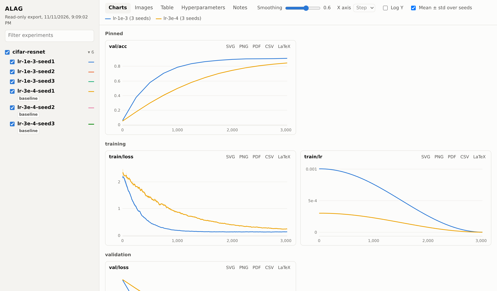

# ALAG

**A** simple **L**ogging **A**nd **G**raphing tool, for researchers.

Log scalars, images and hyperparameters from your training code, then compare runs in a fast local viewer. There's no account, server or database: every run is a plain folder of CSV and JSON files.



[Try the live demo](demo.html){ .md-button .md-button--primary }
[Install](#install){ .md-button }

## Why

Existing experiment trackers ask for more than a researcher who wants to log a run and look at the results should have to give:

- **Weights & Biases** requires an account and other setup.
- **MLflow** needs a tracking server that is heavy for this job, and comparing runs in it feels awkward.
- **TensorBoard** has visualizations that leave a lot to be desired, and makes comparing multiple runs hard.

ALAG aims to do two things well, logging and graphing, without the overhead. Comparing multiple runs is a core feature.

## Install

```sh
pip install alag
```

This gives you the `ALAG` class for your training code and the `alag` command for viewing results. For system metrics, install `pip install 'alag[system]'` instead.

Wheels are built for Linux (x86-64 and ARM, glibc 2.17 or newer), macOS (Intel and Apple Silicon) and Windows. On any other platform, pip builds ALAG from source, which needs [Rust](https://rustup.rs).

## Quick start

Log from your training code:

```python
from alag import ALAG

logger = ALAG(group="my-group", experiment="my-experiment", config={"lr": 3e-4})

for step in range(1000):
    loss = train_step()
    logger.log({"train/loss": loss}, step=step)
```

Then view your experiments:

```sh
alag    # serves ./logs at http://localhost:6100
```

Select experiments in the left panel to compare them. Each metric gets one chart, with a line for every selected experiment, and the page updates while training runs.

Next: [what you can log](logging.md), and [what the viewer can do](viewing.md).
